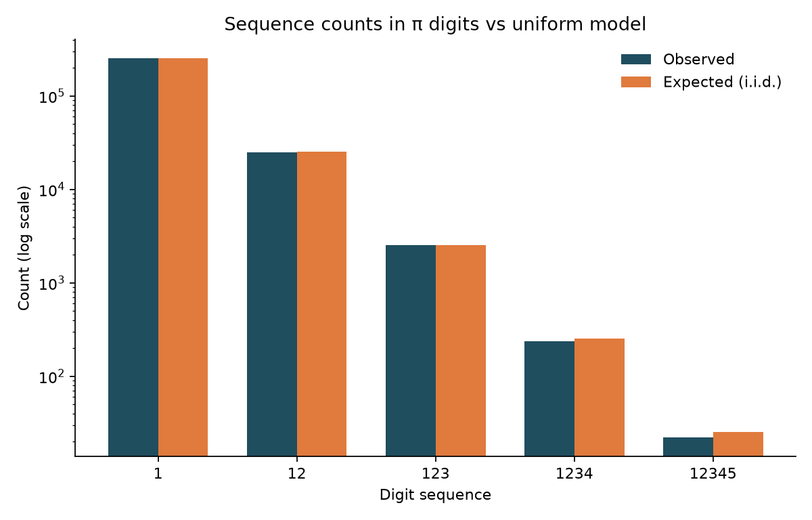
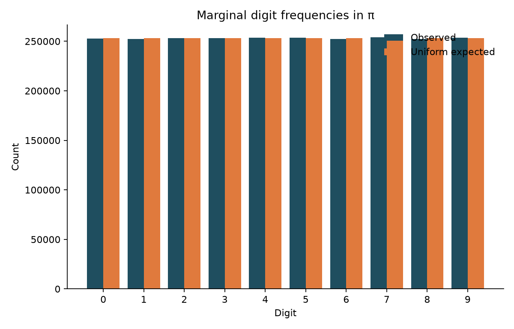
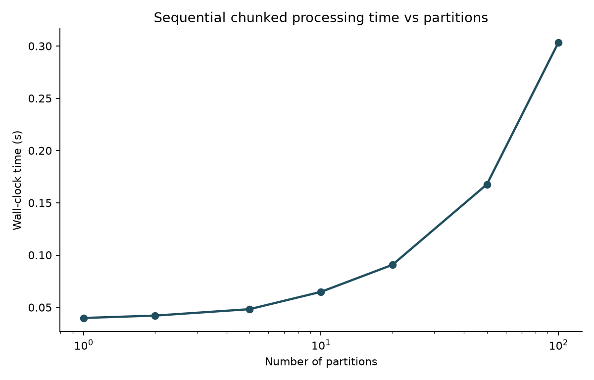
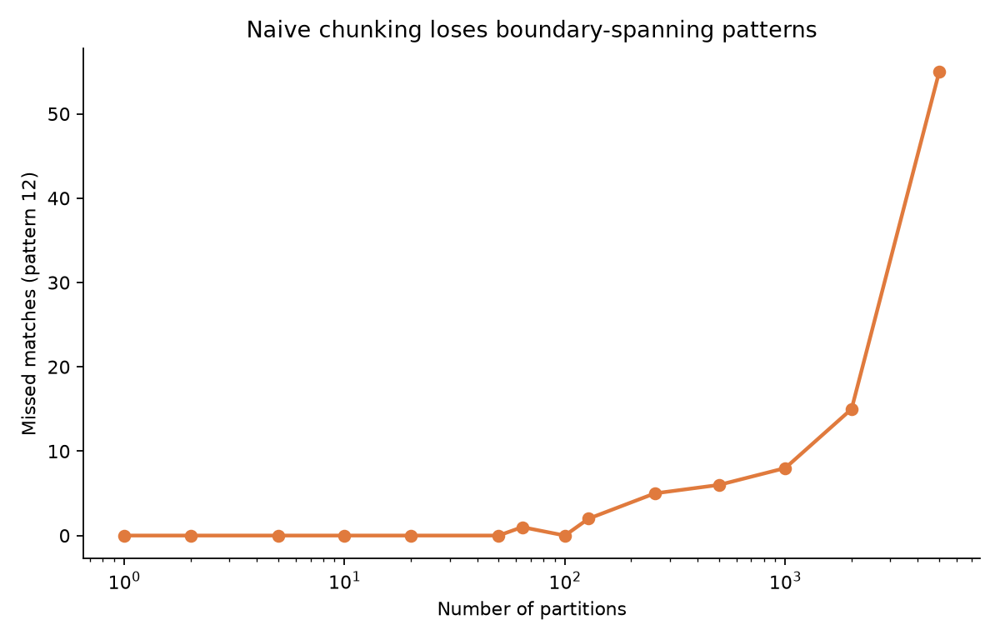
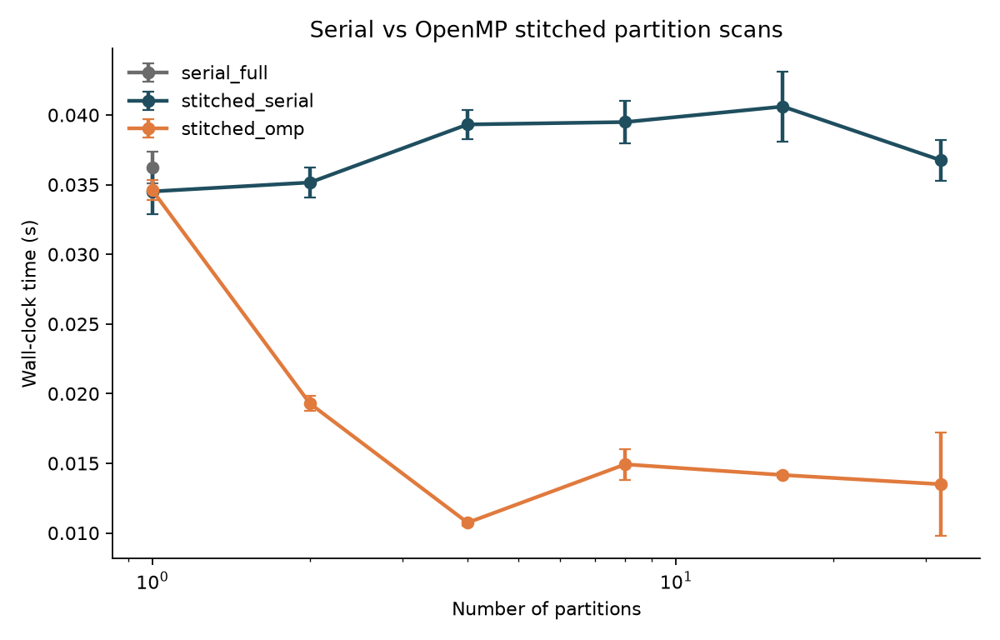

# Digit Sequence Analysis in $\pi$

A computational case study: count ascending digit sequences in the digits of $\pi$, test them against a uniform i.i.d. model, recover matches across partition boundaries, and compare serial vs OpenMP stitched scans.

GitHub **About** blurb and topics: [docs/github-about.md](docs/github-about.md).



---

## Use case

Given a digit expansion of $\pi$, the project answers:

1. **Frequency** — How often do $1$, $12$, $123$, $1234$, and $12345$ appear?
2. **Model fit** — Are counts consistent with $\mathbb{E}[C_k]=(N-k+1)10^{-k}$, and are digit marginals uniform?
3. **Boundary recall** — How many matches does naive file chunking drop at seams, and how does owned-range stitching restore them?
4. **Parallel throughput** — How does an OpenMP stitched partition scan compare to a serial full scan?

$$
\mathbb{E}[C_k] = (N - k + 1)\,10^{-k},
\qquad
z_k \approx \frac{C_k - \mathbb{E}[C_k]}{\sqrt{\mathbb{E}[C_k]\,(1-10^{-k})}}.
$$

| Pattern | Observed | Expected | $z$ | Rel. error |
| --- | ---: | ---: | ---: | ---: |
| `1` | 252478 | 253132.7 | −1.37 | 0.26% |
| `12` | 25069 | 25313.3 | −1.54 | 0.96% |
| `123` | 2527 | 2531.3 | −0.09 | 0.17% |
| `1234` | 237 | 253.1 | −1.01 | 6.4% |
| `12345` | 22 | 25.3 | −0.66 | 13.1% |

---

## Architecture

```
├── include/sequence_counter.h      # Public API (full + stitched partitioned)
├── src/sequence_counter.c          # Counting core (+ OpenMP when enabled)
├── src/main.c                      # CLI
├── bin/pi_counter                  # Serial build
├── bin/pi_counter_omp              # OpenMP build
├── tests/                          # Unit tests (incl. seam stitching)
├── scripts/benchmark.sh            # Sequential file-chunk overhead
├── scripts/verify_partition_recall.py
├── scripts/parallel_bench.sh       # Serial vs OpenMP timings
├── scripts/generate_pi_digits.py   # Optional larger corpora
├── scripts/analyze.py
├── data/pi_digits.txt              # Default ~2.5e6 digits
├── results/  figures/  docs/
└── .github/workflows/ci.yml
```

---

## Build & run

```bash
make                         # serial + OpenMP binaries
make test
make run                     # → results/pattern_counts.csv
make benchmark               # file-chunk overhead (TRIALS=5)
make recall                  # naive misses vs stitched recall
make parallel-bench          # serial vs OpenMP stitched scans
pip install -r requirements.txt
make analyze                 # CSVs + figures
```

```bash
./bin/pi_counter data/pi_digits.txt --csv results/pattern_counts.csv
./bin/pi_counter data/pi_digits.txt --partitions 16
./bin/pi_counter_omp data/pi_digits.txt --partitions 16 --threads 4
N=10000000 make generate-digits    # → data/pi_digits_large.txt (gitignored)
```

---

## Results at a glance









- Sequence counts track the i.i.d. baseline; digit marginals pass uniformity ($\chi^2_9 \approx 11.4$, $p \approx 0.25$).
- Naive byte splits miss seam-spanning patterns; owned-range stitching matches the full-file count.
- File-chunk wall time rises with $P$ (I/O/process overhead). OpenMP stitched partitions target compute parallelism on a single in-memory buffer.

Details: [docs/methodology.md](docs/methodology.md) · Naming: [docs/naming.md](docs/naming.md)

---

## Requirements

- GCC (recommended) or Clang with OpenMP (`libomp-dev` on Ubuntu/Debian)
- GNU `split`, `bash`, `make`
- Python 3.10+ with `numpy`, `matplotlib`

```bash
# Ubuntu/Debian OpenMP headers if Clang is the default cc:
sudo apt-get install -y libomp-dev gcc
make CC=gcc OMP_CC=gcc
```

License: [MIT](LICENSE).
